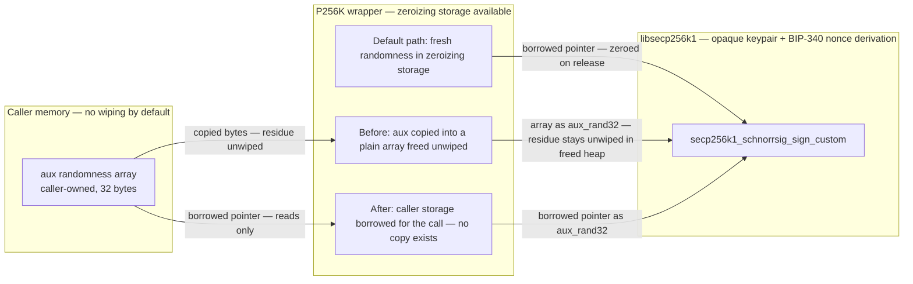
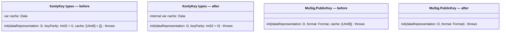
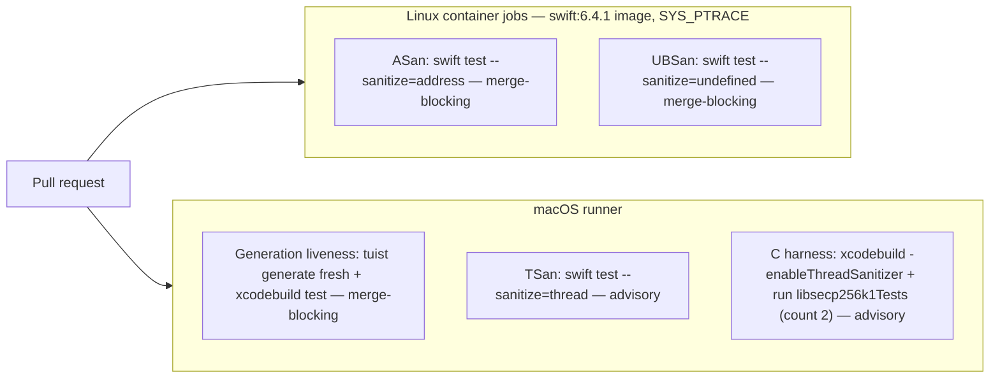

# Audit-hardening wave — Schnorr signing redesign, verify-after-sign, and CI assurance legs

A corrective wave against the findings of an independent two-target security
audit (2026-10-22; evidence ledger: [research.md](./research.md)). The audit
found no correctness defect in the shipped signing or verification paths, but
it measured a set of preventable misuse and assurance gaps: the Schnorr
arbitrary-message entry point signs raw unhashed input with no complaint, no
signing path proves its own output, one convenience overload routes caller
randomness through an un-zeroed array copy, three public accessors named
`bytes` return `[UInt8]` where the library's convention is
`dataRepresentation` returning `Data`, upstream-internal parameters leak into
public initializers, and continuous integration never runs a sanitizer across
the Swift↔C boundary. Consumers are pre-1.0; the wave ships its breaking
changes as one 0.25.0 tag cut after the final breaking change lands, and the
wave's first change-set updates the consumer version-pinning advice in
`README.md` and `Development/constitution.md` — today both tell consumers to
pin `exact:` versions, yet SwiftPM's default `from:` requirement means "any
0.x up to 1.0.0", so an unwarned consumer using `from:` would auto-update
straight into the breakage. Ordered work: [tasks.md](./tasks.md). Evidence:
[research.md](./research.md).

## 1. Goal & success criteria

- The low-level Schnorr signing surface cannot silently sign a raw,
  unhashed, non-32-byte message: the 32-byte and arbitrary-length intents
  are spelled with distinct method names, and auxiliary randomness is a
  length-checked byte container instead of a raw pointer. Measured by a
  test that feeds 100 unhashed bytes and observes a thrown error.
- Every signing path the library ships — Schnorr, ECDSA, recoverable ECDSA,
  and MuSig2 partial signatures — proves its own output before returning:
  a produced signature that fails verification terminates via
  `P256K.invariantFailure` (the existing crash-on-impossible-state channel).
  Measured by fault-injection tests that corrupt the produced bytes and
  observe the channel firing.
- The three public `bytes` accessors get a `Data`-returning
  `dataRepresentation` sibling, with `@available(*, deprecated, renamed:)`
  forwarding aliases that keep the old `[UInt8]` shape until 1.0: old call
  sites compile with only a deprecation warning and a rename fix-it (the
  deprecation practice swift-crypto itself applied for years before removing
  members at a major); **adopting** the new `Data` name is where any
  type adjustment happens, and the migration note says exactly that.
- Continuous integration proves the pointer-heavy Swift↔C boundary on every
  pull request: the memory-error and undefined-behavior sanitizers block
  merges in dedicated Linux container jobs, and the thread sanitizer runs
  macOS-side in advisory mode with a suppression file; a separate job
  regenerates the project's generated Xcode workspace from scratch and runs
  one vector test scheme so a broken regeneration path cannot hide until
  release time.
- Consumer guidance is truthful before the tag: README and the constitution
  recommend `.upToNextMinor(from:)` — the pre-1.0 constraint Apple's own
  packages advise — and the changelog's existing breaking `[Unreleased]`
  entries roll into 0.25.0 as the migration note's opening section.

## 2. Scope

**In scope:**

- Redesign of `P256K.Schnorr.PrivateKey.signature(message:auxiliaryRand:strict:)`
  and its verification counterpart (the five-method surface in §3.1), plus
  the identical retype of the multi-party verifier
  `P256K.MuSig.XonlyKey.isValid(_:for:)` — post-wave, solo and multi-party
  verification share one non-mutating byte-input pattern.
- Verify-after-sign on all four signing paths (§3.2), including the new
  MuSig2 partial-signature self-check.
- Rename-with-alias sweep for the three `bytes` accessors (§3.3), and the
  initializer/accessor trim across the upstream-cache surfaces — both
  x-only types plus `MuSig.PublicKey` (§3.4).
- Four continuous-integration assurance lanes and one contributor note
  (three sanitizers plus generation liveness; §3.5).
- Documentation recipes for the fixed-32-byte signing flow and the
  key-agreement-plus-key-derivation flow (§3.6), including the NIP-44 shape
  verified against the official spec.
- Versioning artifacts: pin-advice change, changelog roll-up, single tag.

**Out of scope (with owners):**

- *Upstream v0.7.1 → v0.8.0 pin bump, bundled with vendoring upstream's
  exhaustive and constant-time test suites* — deliberate deferral; it
  re-validates the vendored C tree and belongs with release tooling, not
  this API wave. Owner: a future spec; recorded in
  `Development/Roadmap/backlog.md`.
- *Code-level HMAC / HKDF / SHA-512 / HMAC-DRBG* — already planned as
  **Phase 5 (SHA-2 tower)** in `Development/Roadmap/phase-5-sha2-tower.md`,
  which will expose the C `secp256k1_hmac_sha256` core. This wave ships the
  *documentation recipe only*, delegating to CryptoKit/swift-crypto `HKDF`,
  so the library grows no hash-function namespace that Phase 5 would later
  have to reconcile. Owner: the Phase 5 spec when scheduled.
- *Custom nonce-function (`noncefp`) exposure* — Roadmap phase 6 (adaptor
  signatures) needs the hook by design; exposing it early without its
  consumer invites speculative API. Owner: Phase 6.
- *Ellswift trait wrap-or-drop* — decision deferred to the v0.8.0 bump,
  whose changelog changes `ellswift_xdh` secret-key validation behavior.
- *Performance work on per-signature keypair rebuilding* — measure-first
  via the existing `Projects/` benchmarks; only if the verify-after-sign
  benchmarks show a real regression does a caching task enter scope.
- *Target A's out-of-box test failure* — the other codebase audited;
  informational to this repo only. Owner: block/buzz.

## 3. Design

### 3.1 Schnorr signing and verification surface redesign

One public entry point today carries four failure modes the audit measured:
a Boolean `strict:` flag defaulting to *off* (silently permitting any message
length), a required `auxiliaryRand: UnsafeMutableRawPointer?` (a raw pointer
whose "point to 32 bytes" contract is invisible to the compiler, and whose
`nil` silently requests deterministic, zero-randomness nonces), an inout
message array (mutability demanded for a buffer never mutated), and an
internal copy of caller randomness that is freed un-zeroed. Three of these
four belong to the raw-message function (`signature(message:auxiliaryRand:
strict:)`); the un-zeroed copy lives in a different public method (the
digest-with-randomness overload). The wave replaces the first function and
retypes the second — both changes stated, numbered, and migration-noted,
under the pre-1.0 policy:

| Call | Behavior |
|---|---|
| `signature(for: digest)` | Unchanged API shape; fresh randomness drawn into zeroizing storage |
| `signature(for: digest, auxiliaryRand: some ContiguousBytes)` | Retyped from `[UInt8]` — same name, same length check, caller's storage borrowed for the C call instead of copied, so the un-zeroed array copy of the audit finding dies. Existing `[UInt8]` call sites compile unchanged (array conforms); binary consumers relink, which the breaking tag permits |
| `signature(message: some ContiguousBytes)` | Exactly 32 bytes or throws `incorrectParameterSize`; fresh randomness |
| `signature(message: some ContiguousBytes, auxiliaryRand: some ContiguousBytes)` | Auxiliary randomness must be exactly 32 bytes; passing a 32-byte zero array reproduces the all-zero-aux BIP-340 vector (index 0) |
| `signature(customMessage:auxiliaryRand:…)` | Any message length (backs upstream's `secp256k1_schnorrsig_sign_custom`) |

This is a **five-method** surface: every pre-redesign public signing method
has a stated fate in this table (the outgoing `strict:`-flagged method's
intents split across the 32-byte and custom rows), and every removal is a
named, migration-noted break.

`nil` is no longer expressible: the all-zero deterministic choice is made by
passing a zeroed byte container, exactly as the vendored header documents
("A NULL argument is treated the same as an all-zero one",
`include/secp256k1_schnorrsig.h`). `ContiguousBytes` — not `InlineArray`
(requires macOS 26) and not `Span` (back-deployment through a compatibility
library that Xcode app bundles do not guarantee) — matches the deployment
floor. Verification mirrors the shape for the raw-bytes overload:
`isValid(_:for:)` takes non-mutating byte containers. The digest overload
`isValidSignature(_:for:)` keeps its `Digest`-typed signature — it is the
`DigestValidator` protocol requirement (conformance at
`Schnorr+Signature.swift:202`; the requirement itself at `EdDSA.swift:39`), so it
changes internally only, stopping the inout array construction. The public
multi-party verifier `P256K.MuSig.XonlyKey.isValid(_:for:)`, which takes
`inout [UInt8]` today (`MuSig+Signing.swift:268`), takes the same
non-mutating byte input in this wave.

The before/after pocket sketch at signature grain (the first application of
`Development/README.md` → "Design diagrams"):

```mermaid
classDiagram
    class `Schnorr.PrivateKey — before` {
        signature(for digest: any Digest) throws
        signature(for digest: any Digest, auxiliaryRand: [UInt8]) throws
        signature(message: inout [UInt8], auxiliaryRand: UnsafeMutableRawPointer?, strict: Bool) throws
    }
    class `Schnorr.PrivateKey — after` {
        signature(for digest: any Digest) throws
        signature(for digest: any Digest, auxiliaryRand: some ContiguousBytes) throws
        signature(message: some ContiguousBytes) throws
        signature(message: some ContiguousBytes, auxiliaryRand: some ContiguousBytes) throws
        signature(customMessage: some ContiguousBytes, auxiliaryRand: some ContiguousBytes) throws
    }
    class `Schnorr.XonlyKey — before` {
        isValidSignature(_ sig: SchnorrSignature, for digest: any Digest) Bool
        isValid(_ sig: SchnorrSignature, for message: inout [UInt8]) Bool
    }
    class `Schnorr.XonlyKey — after` {
        isValidSignature(_ sig: SchnorrSignature, for digest: any Digest) Bool
        isValid(_ sig: SchnorrSignature, for message: some ContiguousBytes) Bool
    }
```

Because this change rewires how secret material (the auxiliary randomness)
is handled across the package's trust boundary, the security-trigger rule in
`Development/README.md` → "Design diagrams" requires a data-flow diagram,
bounded to the delta — what crosses the Swift↔C boundary, by which mechanism
(copy vs. borrow), and whether any residue gets wiped:

Protocol/data-type labels per SDL practice: every arrow into the C side
names the datum (the 32-byte auxiliary input) and the mechanism (copy vs.
borrowed pointer); the two `before` edges are exactly the wave's defect —
the only crossing that leaves unwiped secret-related residue — and they are
the paths this redesign deletes.

What the sketch makes visible that prose alone hid during the audit: every
pre-wave method survives under a name (nothing vanishes silently), while
*one* parameter bundle — `UnsafeMutableRawPointer?` plus a `Bool` called
`strict` —
carried every failure mode (any-length silence, invisible 32-byte contract,
deterministic-by-nil nonces, and a caller-randomness copy). After the
redesign, each intent is a separately named method and every byte input has
its length checked in the type system or at the boundary.

### 3.2 Verify-after-sign, unconditional

Every signature the library produces re-verifies before it escapes.
Precedent and its citations: BIP-340 makes it part of the signing algorithm
itself (footnote 14 on the current master text — *"Verifying the signature
before leaving the signer prevents random or attacker provoked computation
errors"*, with the omission carve-out only for prohibitive cost); upstream
libsecp256k1's signing function documents that it deliberately omits the step
and instructs callers to perform it; Bitcoin Core added it to all three of
its signing paths (PR #22934) and the Ledger hardware-wallet app does the
same. BIP-327's reference MuSig2 implementation ends its `sign()` with the
equivalent `assert partial_sig_verify_internal(...)`. A failure means memory
corruption or a library defect, so the channel is `P256K.invariantFailure`
everywhere, including MuSig2 — every boundary blob has already passed the
wrapper's magic-and-size validation before load, which keeps the state
contractually impossible rather than peer-reachable. The MuSig2 self-verify
closes its last provenance gap before entering the proof: because
`partialSignature(...)`'s `pubnonce` parameter is documented "not
consulted" in the wrapper's own doc comment — upstream's
`secp256k1_musig_partial_sign` takes no pubnonce argument at all, nonce
generation having bound it inside the secnonce — `SecureNonce` retains
the companion public nonce from its `Nonce.generate` pair, and
mismatched caller-supplied pubnonces
throw `underlyingCryptoError` before any C call — the self-verify then
proves against material whose provenance is established, never against a
caller-input that could otherwise reach the crash channel (BIP-327's
reference `Sign()` recomputes the public nonce from the secret-nonce
scalars inside the function; carrying the companion is the equivalent the
opaque-struct rule permits here). ECDSA verifies the parsed signature
struct directly (no compact round-trip). The benchmark CI workflow runs on
these PRs to quantify the cost of one extra verification per signature.

### 3.3 Renames with deprecation aliases

Three public accessors named `bytes` accrue on key types
(`ECDSA+XonlyKey.swift:48`, `Schnorr+XonlyKey.swift:50`, `MuSig.swift:243`),
all returning `[UInt8]`. The library-wide convention — eleven public
`var dataRepresentation: Data` declarations (reproducible:
`grep -rh 'public var dataRepresentation' Sources/P256K --include='*.swift' | wc -l`) — is
`dataRepresentation: Data`. All three gain a `Data`-returning
`dataRepresentation` in one change; the old names stay public-deprecated
with `@available(*, deprecated, renamed:)`, forwarding with the old
`[UInt8]` shape until 1.0, matching the mechanism already on `main` for
`Utility.swift`'s `bytes → byteArray` (same-type forwarder) and
swift-crypto's own keep-deprecated-then-remove-at-major practice
(its 4.0 major removed setter members deprecated years earlier).
(swift-crypto's own accessor family name is `rawRepresentation`;
self-consistency with the existing convention wins over cross-package
matching.)

### 3.4 Public-initializer trim for the upstream-cache surfaces

Three public initializers hand callers the opaque
`secp256k1_musig_keyagg_cache` blob as `[UInt8]` —
`Schnorr.XonlyKey.init(dataRepresentation:keyParity:cache:)` (the
audit's finding), `MuSig.XonlyKey.init(dataRepresentation:keyParity:
cache:)` (both also exposing `keyParity: Int32`), and
`MuSig.PublicKey.init(dataRepresentation:format:cache:)` — the only
site where the blob is *required* rather than defaulted — with a public
`cache` accessor on each x-only type to supply it. Upstream's contract
settles the remedy: `include/secp256k1_musig.h` gives the opaque
`secp256k1_musig_keyagg_cache` "No serialization and parsing functions
(yet)" and warns it is "not guaranteed to be portable between different
platforms or versions", so a public byte parameter is a wrapper-invented
serialization upstream deliberately withholds. The reference bindings
agree — `rust-secp256k1`'s `musig::KeyAggCache` has private fields and a
single re-aggregation constructor, `btclib-secp256k1` wraps it as a
declined no-serialization handle, and Bitcoin Core's merged MuSig2 wallet
keeps all signing session state in memory, re-deriving from the
participant pubkeys on restart (citations in `research.md` §B). So the
trim reaches all five sites: the public initializers take the key bytes,
parity stays an explicitly labeled parameter where the type truly needs
it, and the cache-taking initializers and public `cache` accessors move
internal. A reconstructed aggregate is then verification-only — resuming
a signing session means re-running `MuSig.aggregate(_:)` on the
participant pubkeys, the deterministic, version-safe path upstream
designed. `MuSig.PublicKey.init(xonlyKey:)` stays public — it reads the
now-internal `cache` accessor in-module. The ECDSA `Signing.XonlyKey`
(`init(dataRepresentation:keyParity:)`) needs nothing: it has no cache
to leak. Hard break on all three initializers, flagged in the migration
note — consumers persisting cache bytes keep the member pubkeys and
re-aggregate instead.

The pocket sketch for the removed surfaces (signature grain, shared
verbatim with the migration note — `internal` marks what moves out of
public reach):

### 3.5 Continuous-integration assurance legs

The lane topology (`Development/README.md` → "Design diagrams," deployment
row — the first instance of a CI change carrying its own figure):

Four additive lanes — ASan and UBSan (Linux, merge-blocking), thread
sanitizer including the sanitized C-harness step (macOS, advisory together),
and generation liveness (macOS-only by tool, merge-blocking) — following
`.github/AGENTS.md` conventions (`permissions:
{}` on each new job, `env:` blocks, no new third-party actions, verdict
steps gated `!cancelled()`):

1. **Sanitizer lane** — `swift test --sanitize=address` and
   `swift test --sanitize=undefined`, each its own merge-blocking job on
   `ubuntu-latest` inside `container: swift:6.4.1` — the image the
   Dockerfile already pins — with `options: --cap-add SYS_PTRACE`.
   Container jobs rather than the existing `docker build` lane because
   LeakSanitizer, bundled inside ASan on Linux, attaches to the process
   through `ptrace`, which Docker denies by default and a `docker build`
   step cannot be granted at all; `container.options` accepts any
   `docker create` flag, and checkout plus the repo's `env:` and
   `permissions: {}` conventions work natively inside it — no new
   third-party actions. Each job repeats the existing lane's `--traits
   ecdh,musig,recovery,schnorrsig,uint256` for parity — `--traits`
   *replaces* the default trait set, so a flagless run would silently
   drop the `uint256` sources and tests — and UBSan runs with
   `UBSAN_OPTIONS=print_stacktrace=1:halt_on_error=1` so reports fail
   the job rather than warn. `swift test --sanitize=thread` on the
   macOS runner in advisory mode (reports land in the job summary;
   promotion to blocking after a stability window), with a
   `TSAN_OPTIONS` suppression file after Bitcoin Core's documented
   pattern and `halt_on_error=1`. Each sanitizer is a separate job
   with its own scratch path — sanitizer-instrumented object files
   from different sanitizers must not share a build directory.
   Platform placement is evidence-driven: 2026 Swift-forums operational
   reports (Apple's Jon Shier; Vapor's Tim Condon) put thread-sanitizer
   false-positive rates near 50% on Linux versus reliable on macOS for
   current toolchains. Two instrumentations stay distinct here: sanitizer
   flags propagate to C sources under SwiftPM, so *every* sanitized
   `swift test` run already instruments the vendored `libsecp256k1` target —
   the shipped C bytes execute under the sanitizer whenever the Swift suite
   calls into them. What that never runs is upstream's hand-written test
   harness (`tests.c`, vendored under `Projects/Sources/libsecp256k1Tests`
   as a Tuist-only macOS command-line tool with no SwiftPM or Linux path).
   The macOS thread-sanitizer lane therefore adds one concrete step — build
   `libsecp256k1Tests` with `xcodebuild -enableThreadSanitizer YES` and
   execute the binary with `TSAN_OPTIONS=halt_on_error=1` at a low iteration
   count (the flow Apple documents for sanitized command-line targets in
   WWDC 2016 session 412) — so upstream's own harness runs instrumented
   without inventing
   Linux build machinery for a documentedly macOS-only target.
2. **Generation liveness** — on pull requests, regenerate the Tuist-managed
   Xcode project fresh and run one vector test scheme through `xcodebuild
   test`. Release CI already *regenerates the project*
   (`xcframework-release.yml:25`), but only at release time and without a
   PR-time test of the regeneration path; this lane catches a broken
   regeneration on the change that causes it. macOS-only by tool (Tuist and
   `xcodebuild`). A companion note in `Projects/AGENTS.md` tells contributors
   the generated project is git-ignored and can go stale locally — delete
   and re-run the documented generate command.

### 3.6 Documentation recipes (no protocol-named API)

Two DocC catalog articles, each mirrored by a test that compiles its exact
code. Both recipes use only building blocks this library plus
CryptoKit/swift-crypto already provide — no protocol-specific API ships.

- **Fixed-32-byte signing flow** (the sequence Nostr event signing needs):
  hash to 32 bytes, sign via the 32-byte-checked method from §3.1, verify
  against the x-only key.
- **Key agreement plus key derivation**: the shared-secret type yields its
  bytes through its documented extraction accessor; the recipe slices the
  compressed-point prefix byte to obtain the bare 32-byte shared x
  coordinate and feeds it (unhashed — verified against `nips/44.md`) to
  `HKDF<SHA256>.deriveKey(...)` from CryptoKit or swift-crypto with the
  caller's chosen salt (NIP-44 v2 uses the UTF-8 bytes of the string
  `nip44-v2`). The article states plainly that the recipe is an example
  composition, not a Nostr implementation.

### 3.7 Versioning and migration artifacts

One tag — 0.25.0 — cut after the last breaking change lands; no tag between
breaking changes. The first change-set of the wave updates consumer advice:
`README.md:39`'s `exact:` example becomes `.upToNextMinor(from: "0.24.0")`
with a sentence explaining that SwiftPM's `from:` spans all of 0.x up to
1.0.0 and a note that the example moves to `0.25.0` when the tag is cut —
a published example never names an untagged version, so the tag-time bump
rides in the release task, not here. `Development/constitution.md`'s
Versioning & Stability section trades "Users advised to pin exact
versions" for the same advice (Apple's pre-1.0 wording, used on
swift-configuration, is the template). The changelog's existing breaking
`[Unreleased]` entries open the 0.25.0 section, followed by this wave's.
Every breaking change-set extends the migration note in the same edit.
Pre-1.0, the minor version *is* the stability boundary — the wave's
breaking work batches into 0.25.0 rather than waiting for a major.

## 4. Implementation steps

Ordered reviewable slices with checkpoints are in
[tasks.md](./tasks.md). Headline order: versioning artifacts first; the
Schnorr redesign; verify-after-sign on its four paths; rename sweep;
initializer trim; tag 0.25.0; then documentation recipes and CI legs,
which interleave freely.

## 5. Verification

- [ ] `swift test` green; `swift package swiftlint` and formatting hooks clean.
- [ ] All official BIP-340 vectors (19 rows) pass through the redesigned API,
      each signing row driven with its declared `auxRand` — index 0 supplies
      the all-zero case; the remaining rows are verify-only.
- [ ] New tests: 100-byte unhashed input throws via the 32-byte method;
      `customMessage:` signs and round-trips; fault-injection tests fire
      `invariantFailure` on corrupted outputs for all four signing paths.
- [ ] Deprecated aliases compile existing call sites with warnings.
- [ ] `benchmark-pr.yml` comparisons attached to the verify-after-sign PRs.
- [ ] Sanitizer jobs green on the wave's final state; TSan job summary
      attached as non-blocking evidence.
- [ ] Generation-liveness job regenerates and passes on a pull request
      whose only change is a new source file (the regression class observed
      during the audit).
- [ ] `swift run --package-path Development/Tools plans --check` and
      `vale Development/` clean; DocC builds with the two new articles.
- [ ] A scratch consumer package pinned `from: "0.25.0"` builds; a scratch
      package consuming the pre-wave API fails to compile with clear,
      migration-note-mapped errors at each removed/changed symbol.

## 6. Risks and mitigations

- **`from:`-pinned consumers auto-update into the break.** Mitigation: the
  pin-advice change lives in the wave's first change-set, the tag lands only
  after every breaking change, and the changelog names each removed symbol
  with its replacement.
- **Verify-after-sign regresses signing latency.** Mitigation: benchmark CI
  runs on the hardening PRs; no published baseline exists, so the wave
  establishes it rather than guessing.
- **TSan advisory job rots.** Mitigation: explicit promotion criteria
  (N consecutive clean weeks) written into the workflow, matching the repo's
  existing advisory-gate convention.
- **The custom-message path drifts into routine use.** Mitigation: the
  method name is deliberately unattractive and its DocC comment states the
  BIP-340 domain-separation requirement.
- **NIP-44 recipe rots against the spec.** Mitigation: the article links
  `nips/44.md` and states the composition is example-grade; the companion
  test asserts only the library's own steps, not the payload format.

## 7. Out of scope (follow-ups)

Tracked as backlog owners per §2: the v0.8.0 pin bump + constant-time and
exhaustive suite vendoring (seed for a future spec); code-level HMAC/HKDF
(Phase 5); `noncefp` exposure (Phase 6); ellswift trait decision;
benchmark-driven keypair caching only if measured.

## 8. Division of labor

Each `tasks.md` entry is one independently-implementable change-set with its
files, acceptance evidence, and dependencies. Slices are sized for a
reviewer: nothing over ~300 authored lines; the spec documents ship as one
coherent set. No task touches `Sources/libsecp256k1/`,
`Sources/P256K/swift-crypto/`, or `vendir.yml`/`vendir.lock.yml` — the
vendored trees are vendir-managed and untouched this wave.
