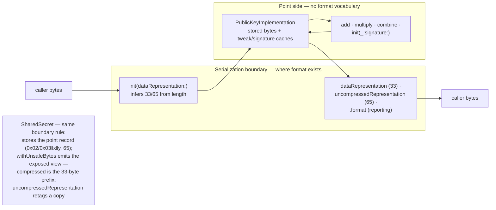

# Remove `format:` parameters — representations at the boundary, points inside

GHSA-7g3x-fj89-693j exposed `MuSig.PublicKey.add(_:format:)` feeding a caller-chosen
*output* format into the *input* parse of stored bytes — a reachable state that was
misclassified as unreachable. The 0.25.x fix restores the parameter's documented
contract; this feature removes the parameter class that admitted the bug. `P256K.Format`
itself stays as the stored-form vocabulary (`.format`, `.length`, internal serialize
flags). What goes away is `format:` *as a caller-supplied parameter* everywhere it names
a pure representation choice: public-key operations always return compressed storage,
65-byte output moves to `uncompressedRepresentation` accessors (already present on two
of five public-key types, added here to the other three), and byte-describing
initializers infer 33-vs-65 from `data.count` — `secp256k1_ec_pubkey_parse` sniffs the
tag either way, so the label was redundant. The last parameter,
`sharedSecretFromKeyAgreement(with:format:)`, looked exceptional because it selects the
shared secret's *own bytes* — but the 33-byte compressed secret encodes the full point,
so the 65-byte form moves to `SharedSecret.uncompressedRepresentation` like every other
site, the dead `SharedSecret.format` record is deleted, and no public `format:`
parameter survives. Ordered work: tasks.md. Evidence: research.md.

## 1. Goal & success criteria

- No *non-deprecated* public `format:` parameter remains — the ECDH variant that
  looked exceptional deprecates like the rest. `grep -rn 'format: P256K.Format'
  Sources/P256K` returns only expected survivors: the `@available(*, deprecated)`
  forwarding shims enumerated in research.md §4 (kept until 1.0), the public `.format`
  reporting properties, and internal parameters. `SharedSecret`'s write-only `format`
  record is deleted; the deprecated shim's exposed-view discrimination moves to an
  internal `exposedForm` tag — the stored point's count can no longer discriminate
  (it is always 65), so unlike the deleted write-only record this one is actually read.
- Every public-key type (`Signing`, `Recovery`, `Schnorr`, `MuSig`, `KeyAgreement`)
  can produce a 65-byte `uncompressedRepresentation`; the three accessors added here
  match the two that exist byte-for-byte. `SharedSecret` gains the same accessor —
  the point record captured inside `secp256k1_ecdh` in constant time, copied and
  retagged `0x04` at the boundary — not a re-parse of secret bytes
  (recorded decision in §6).
- Every removal lands with a replacement named: bare overloads for operations,
  inferred-length initializers for byte inputs, `uncompressedRepresentation` for
  65-byte output, `init()`/`init(dataRepresentation:)` for private keys — plus
  `init(_:)` on `Signing.PrivateKey`, the only private-key type with a `UInt256`
  initializer today (`ECDSA+PrivateKey.swift:239`).
- Deprecated shims preserve observable behavior for callers who keep the explicit
  `format:` label — same stored format, same thrown error class (`incorrectKeySize`
  where a length/format mismatch threw before) — so a caller who ignores the warning
  sees no behavioral change.
- Un-parametered call shapes keep compiling without warnings where they exist today:
  `PrivateKey()` and `add(tweak)` resolve to the new overloads (Swift prefers the
  candidate requiring fewer default arguments — the ambiguity check is in §6).
  `PublicKey(dataRepresentation: bytes)` is new API on `Signing`, `Schnorr`, and
  `MuSig` — their `init(dataRepresentation:format:)` declares no default — and a
  documented `Breaking:` widening on `KeyAgreement` (recorded decision in §3).
  `sharedSecretFromKeyAgreement(with:)` keeps resolving warning-free too: the
  formerly-internal `DiffieHellmanKeyAgreement` witness goes `public` carrying
  the `.compressed` body, so the call shape that used the `format:` default
  lands on the new method.

## 2. Scope

**In scope:**

- 18 removable `format:` sites across `Sources/P256K/` — full taxonomy in research.md §4:
  - Operations (7): `MuSig.PublicKey.add`, `Signing.PublicKey.add`, `Signing.PublicKey.multiply`,
    `Signing.PublicKey.combine`, `Recovery.PublicKey.init(_:signature:format:)` ×2 overloads,
    `KeyAgreement.PrivateKey.sharedSecretFromKeyAgreement(with:format:)`.
  - Private-key initializers (7): `Signing.PrivateKey` ×3, `Recovery.PrivateKey` ×2,
    `KeyAgreement.PrivateKey` ×2 — the parameter only ever steered the companion
    `publicKey`'s stored form; private-key input bytes are always a 32-byte scalar.
  - Public-key byte initializers (4): `Signing`, `Schnorr`, `MuSig`, `KeyAgreement`
    `init(dataRepresentation:format:)` — replaced by `init(dataRepresentation:)`
    inferring format from byte count.
- Four new `uncompressedRepresentation` accessors (`Recovery.PublicKey`,
  `Schnorr.PublicKey`, `MuSig.PublicKey`, `SharedSecret`).
- Deletion of `SharedSecret`'s write-only `format` stored property — nothing read
  it, and `ss.count` discriminated the stored form identically.
- `SharedSecret` storage refactor (internal only — no signature delta; the §6
  equality tighten is publicly observable): the secret stores the captured
  65-byte point itself, plus an internal `exposedForm` tag recording which
  serialization `withUnsafeBytes(_:)` emits; every byte accessor derives from
  that single stored form.
- `secp256k1_ecdh`'s `hashfp` plumbing and `hashClosure()` — the callback now
  always captures the 65-byte `0x04‖x‖y` point (its tag rewritten to
  `0x02`/`0x03` in place) and ignores its `data` argument; `deriveSharedSecret`
  no longer passes it a format flag.
- Deprecated forwarding shims for every removed signature.
- DocC article and doc-comment updates wherever `format:` is named; `[Unreleased]`
  CHANGELOG `Breaking:`/`Deprecated:` entries.

**Out of scope (with owners):**

- The GHSA-7g3x-fj89-693j fix itself — already landed; this spec removes the class, it is not the patch.
- `P256K.Format` enum and the public `.format` property — stay. Uncompressed storage
  remains reachable via inferred initializers, so `.format` still reports a real state.
- Internal `format:` parameters on `PublicKeyImplementation` / `PrivateKeyImplementation` /
  `XonlyKeyImplementation` — they are how stored form is set; deprecated public shims
  forward through them.
- Vendored `Sources/libsecp256k1/` — untouched.
- Actual deletion of the deprecated shims — happens at 1.0 alongside the existing
  `Deprecated:` aliases from 0.25.0 (`.bytes`, `normalize`, `create()`).

## 3. Design

The principle: **representations live at the serialization boundary; points live
inside.** A `format:` parameter is legitimate exactly where caller bytes cross the
boundary — and even there, only when the bytes can't describe themselves. Full SEC
public keys are self-describing (33/65 length + 0x02/0x03/0x04 tag), so the parameter
was redundant at every public-key site. Inside the boundary, an EC point has no format;
the bug this spec retires existed only because an interior call-site let a boundary
vocabulary word (`format`) leak into a second parse that had no business knowing it.



Before/after pocket sketch:

```swift
// Before (0.25.x)
try key.add(tweak, format: .uncompressed)
try P256K.Signing.PublicKey(dataRepresentation: bytes, format: .uncompressed)
try P256K.Signing.PrivateKey(format: .uncompressed)          // companion publicKey uncompressed
let ss = try priv.sharedSecretFromKeyAgreement(with: pub, format: .uncompressed)

// After (this spec)
try key.add(tweak)                                           // always compressed storage
tweaked.uncompressedRepresentation                           // 65 bytes on demand
try P256K.Signing.PublicKey(dataRepresentation: bytes)       // 33/65 sniffed from bytes.count
try P256K.Signing.PrivateKey()                               // companion publicKey compressed
priv.publicKey.uncompressedRepresentation                    // 65 bytes on demand
let ss = priv.sharedSecretFromKeyAgreement(with: pub)
ss.uncompressedRepresentation                                // 65 bytes on demand
```

Deprecations, not hard removals: the repo's convention (0.25.0's `.bytes` →
`dataRepresentation`, `normalize` → `signature`, `create()` aliases) keeps renamed or
replaced API forwarding until 1.0. Only the four byte initializers earn
`@available(*, deprecated, renamed:)` — `init(dataRepresentation:format:)` →
`init(dataRepresentation:)` is output-identical for both labels, since inference maps
65 bytes to `.uncompressed`. Every other `format:` overload gets
`@available(*, deprecated, message:)` naming the two-step migration — drop the label
for the compressed-storing replacement, then `uncompressedRepresentation` for 65-byte
output — because a `renamed:` fix-it on `add(t, format: .uncompressed)` would silently
shrink `dataRepresentation` from 65 to 33 bytes. Shims forward to the existing internal
machinery, so `PrivateKey(format: .uncompressed)` still yields an uncompressed-stored
`publicKey` until the shim is deleted.

Inference rule: a new internal `P256K.Format.inferred(serializedPublicKeyCount:)` maps
33 → `.compressed`, 65 → `.uncompressed`, anything else → throw
`secp256k1Error.incorrectKeySize` — the same error the explicit-length check produced,
so error behavior is preserved for malformed input. The C parser's tag check then does
what it always did.

Recorded decision — widened byte-init acceptance (`Breaking:`): inference accepts
whatever `secp256k1_eckey_pubkey_parse` accepts at a given length — standard `0x04`
uncompressed keys *and* legacy hybrid `0x06`/`0x07` encodings at 65 bytes
(`eckey_impl.h:22-32`), matching upstream `secp256k1_ec_pubkey_parse` and
rust-secp256k1's `PublicKey::from_slice` (research.md §2). Only one call shape
silently widens: `KeyAgreement.PublicKey(dataRepresentation:)`, the sole public-key
byte initializer declaring a `format:` default today (`ECDH.swift:118`); the same call
on `Signing`, `Schnorr`, and `MuSig` is new API. Callers who used that bare call as a
compressed-only filter must check `data.count == 33` themselves — no compressed-only
labeled variant is added, since a label for the old behavior would re-admit the
vocabulary this spec removes. A hybrid-ingested key stores `.uncompressed` and
reserializes canonical `0x04`: the ingest path reserializes the parsed point inside
`XonlyKeyImplementation.generate`, so `dataRepresentation`/`uncompressedRepresentation`
never echo `0x06`/`0x07` — the same parse-lenient/emit-canonical architecture
libsecp256k1 and rust-secp256k1 (`PublicKey::from_slice`) both follow. T014
carries the `[Unreleased]` `Breaking:` entry and the migration note.

## 4. Implementation steps

Ordered as review slices in tasks.md:

1. **Accessors** — add `uncompressedRepresentation` to `Recovery.PublicKey`,
   `Schnorr.PublicKey`, `MuSig.PublicKey` (each delegates to the stored
   `PublicKeyImplementation` serialization path the existing two accessors use);
   same-value tests against `dataRepresentation` for the stored-format-independent
   contract. Non-breaking; could land ahead of the rest.
2. **Inferred initializers** — internal `Format.inferred(serializedPublicKeyCount:)`;
   `init(dataRepresentation:)` on `Signing`, `Schnorr`, `MuSig`, `KeyAgreement`
   public keys; deprecate `init(dataRepresentation:format:)` forwarding through a
   `count == format.length` check so `incorrectKeySize` semantics are preserved.
3. **Bare operations** — `add(_:)`, `multiply(_:)`, `combine(_:)`, and
   `Recovery.PublicKey.init(_:signature:)` without `format`; deprecate the
   `format:` overloads, keeping their bodies so `.uncompressed` still stores
   uncompressed until 1.0.
4. **Private-key initializers** — `init()`, `init(_:)`, `init(dataRepresentation:)`
   producing compressed companion `publicKey`s; deprecate the `format:` variants.
5. **ECDH shared secret** — `SharedSecret.uncompressedRepresentation` (the 65-byte
   form is captured inside `secp256k1_ecdh`, where both coordinates exist in
   constant time, so it is an accessor, not a parameter); the internal
   `DiffieHellmanKeyAgreement` witness goes `public` carrying the `.compressed`
   body; `sharedSecretFromKeyAgreement(with:format:)`
   deprecates like every other site; the write-only `SharedSecret.format` record
   is deleted. Same slice, second step: `SharedSecret` stores the captured point
   itself — a 65-byte `0x02/0x03‖x‖y` record (the capture with its tag rewritten,
   so the compressed view is a prefix borrow) is the single storage, with an
   internal `exposedForm` tag carrying the deprecated shim's observable view — so
   every byte accessor is a total boundary derivation rather than a serialization
   the type must keep consistent.
6. **Docs + bookkeeping** — doc-comment and DocC article updates, CHANGELOG
   `Breaking:`/`Deprecated:` entries.

## 5. Verification

- [ ] `grep -rn 'format: P256K.Format' Sources/P256K` — no *non-deprecated* public
      parameter survives; every public match is an enumerated survivor: a
      `@available(*, deprecated)` forwarding shim at a research.md §4 site (kept
      until 1.0), a public `.format` reporting property, or an internal parameter
      (the implementation `format:`s). Any match outside those categories fails
      this check.
- [ ] `swift build` clean: un-parametered calls (`PrivateKey()`, `add(t)`,
      `PublicKey(dataRepresentation: b)`) resolve without deprecation warnings.
- [ ] `swift test`: every `uncompressedRepresentation` returns the same point as
      the stored form, checked by SEC1 byte correspondence on all five
      public-key types and `SharedSecret` — `0x04` tag, identical X coordinate
      in bytes 1–32, and
      byte 64's low bit matching the compressed tag's `0x02`/`0x03` parity (the
      `serialize33`/`serialize65` contract in vendored `eckey_impl.h:38-55`), so no
      `xonly`/`parity` accessor is needed (`Recovery.PublicKey` has neither);
      inferred inits accept 33/65 — including valid 65-byte hybrid `0x06`/`0x07`
      vectors, which store `.uncompressed` and reserialize canonical `0x04` — and
      reject other lengths with `incorrectKeySize`; deprecated paths produce
      byte-identical results.
- [ ] Compile check that `add(t, format: .uncompressed)` and friends warn but work.
- [ ] DocC build clean — no dangling `format:` symbol references.

## 6. Risks and mitigations

- **Overload ambiguity.** `add(t)` could in principle match both `add(_:)` and
  deprecated `add(_:format:)`. Swift prefers the candidate needing fewer default
  arguments; compile-verified in group 3, and if
  any site still resolves to the deprecated overload silently, drop the default from
  the deprecated signature.
- **Error-class drift on deprecated initializers.** Forwarding `init(dataRepresentation:format:)`
  straight to inference would let `<65B>, format: .compressed` succeed where it used
  to throw. Every deprecated byte-initializer first asserts `data.count == format.length`,
  preserving `incorrectKeySize` for mismatched labels.
- **Capability loss.** Removing `.uncompressed` output with no accessor would strand
  callers who need 65-byte keys — mitigated by ordering: the accessor group lands
  first, and the sweep covers all five public-key types, not just the reported site.
- **Constant-time coverage of 65-byte ECDH output (recorded decision).**
  `secp256k1_ecdh` advertises "in constant time" — but a re-parse-based accessor
  would run the *secret* shared point through `secp256k1_ec_pubkey_parse`'s
  variable-time primitives (`ge_set_xo_var`, `fe_normalize_var` — `field.h:120-124`
  documents "not constant time in r"), carving a hole in the contract the module
  advertises, and after the deprecated shim's 1.0 deletion it would be the *only*
  route to 65 bytes. Instead the hash closure always writes the 65-byte SEC1 form
  into `SecureBytes` storage while upstream still holds both coordinates in
  constant time — the same arrangement upstream's own `ecdh_hash_function_custom`
  test (which writes `0x04‖x‖y` in the callback and byte-compares against
  `serialize`'s uncompressed output) and rust-secp256k1's `shared_secret_point`
  use — and the capture becomes `SharedSecret`'s storage after one branchless
  tag-byte rewrite (`0x04` → `0x02 | (y & 1)`): the stored record `tag‖x‖y`
  holds the full point in a single `SecureBytes` field, so no serialization the
  type stores can ever need expanding. The 33-byte compressed view is then the
  record's prefix — a borrow with no derivation at all — and
  `uncompressedRepresentation` is a `SecureBytes`→`Data` copy with byte 0
  retagged `0x04`: constant-time production with no re-parse, no
  `secp256k1_pubkey` stack copy, no secret-bearing plain arrays — and the
  constant-time route survives the shim's deletion.
- **`SharedSecret` storage shape and equality (recorded decision).** Storing the
  point — rather than one exposed serialization plus an optional second form —
  makes "a compressed-only secret" unconstructible at every site, test fixtures
  included: the internal `init(point:exposedForm:)` requires the 65-byte
  `tag‖x‖y` record, so `uncompressedRepresentation` is total and carries no
  invariant-failure branch. The record leads with the *compressed* tag
  (`0x02/0x03‖x‖y`, produced by one branchless rewrite of the `0x04‖x‖y`
  capture) rather than the canonical `0x04` tag: that keeps the hot
  `withUnsafeBytes` path a zero-copy borrow — the `.compressed` view is the
  record's 33-byte prefix — while every 65-byte read was already a copy, so
  moving the tag-byte derivation from per-access materialization into
  construction costs the deprecated `.uncompressed` view alone a
  `SecureBytes` temp. `exposedForm` is an internal `P256K.Format` record of which
  serialization `withUnsafeBytes(_:)` emits — `.uncompressed` only under the
  deprecated shim, whose 65-byte `withUnsafeBytes` contract it preserves until
  1.0 — internal bookkeeping, not the deleted write-only public record, and it
  deletes with the shim. `==`/`hash` compare the stored point record —
  `safeCompare` over the 65 bytes, keeping the existing constant-time
  guarantee: a canonical secret and a deprecated-`.uncompressed` secret over
  the same shared point are the same shared secret, a deliberate (and publicly
  observable — CHANGELOG-noted) tighten over comparing stored serializations. `description` reports the exposed view's byte count, keeping
  the redaction contract's 33/65 pins — fixtures construct
  `init(point:exposedForm:)` with a `tag‖x‖y` stand-in.
- **`.format` property staleness.** Left public and honest: uncompressed storage is
  still reachable through inferred initializers, so the property still varies.

## 7. Out of scope (follow-ups)

- Internal `format:` parameters could slim further (e.g. `PrivateKeyImplementation`
  always storing compressed) once callers can't reach uncompressed storage — revisit
  at 1.0 shim deletion. `SharedSecret.exposedForm` deletes in the same sweep —
  without the deprecated `.uncompressed` path every secret exposes the compressed
  view unconditionally.
- If `uncompressedRepresentation` proves the whole uncompressed-storage story,
  `.format` as a public property could deprecate too — deferred; inference keeps
  uncompressed storage reachable today.
- The boundary principle itself (representations at the boundary, points inside) is a
  candidate for ADR 0009 once this ships — it is the generalization this advisory
  taught.

## 8. Division of labor

Review slices map to tasks.md groups: Accessors (T001–T004), Inferred initializers
(T005–T007), Bare operations (T008–T010), Private-key initializers (T011–T012),
ECDH shared secret (T013–T014), Docs + bookkeeping (T015). The accessor group is
self-contained and non-breaking — a valid standalone early PR; the rest lands as
one breaking-change PR in commit order.
