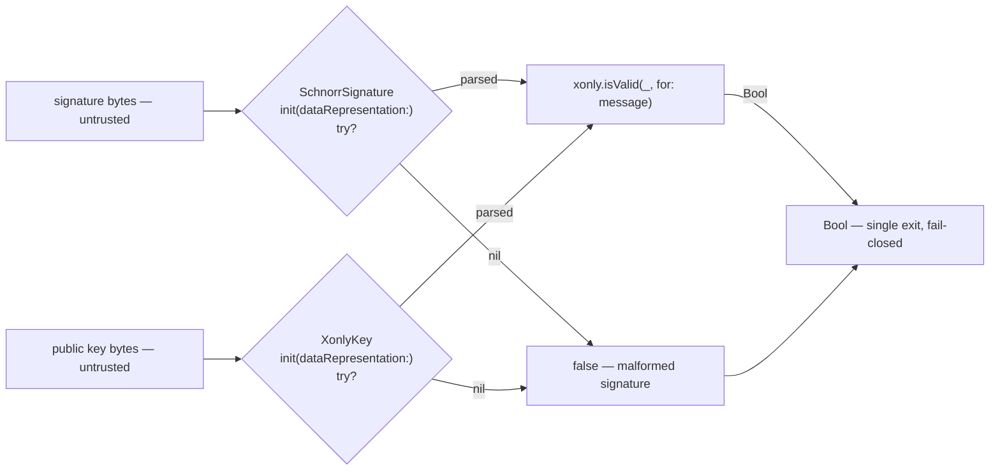

# Non-throwing signing and key generation, plus a fail-closed one-shot verifier

A downstream consumer's dependency bump (0.24.0 → 0.25.1) failed its CI on the
0.25.0 breaking changes — all four errors were documented migrations, and the
consumer's fix already landed. The incident prompted an audit of the package's
whole throwing surface (evidence: [research.md](./research.md)): every `throws`
on a parsing or key-validation initializer is the validation boundary itself
and cannot shrink honestly, but the audit surfaced three reductions. Two
`throws` are dead — they mark methods containing zero throwing calls,
retained in 0.25.0 only to limit that release's blast radius — and a third
is RNG-bound: the four public key-generation initializers throw because a
single random draw could produce an invalid scalar (P ≈ 2⁻¹²⁸), where the
standard keygen pattern is draw→verify→*retry*, which makes the failure
unreachable outright. This spec completes the audit-hardening redesign the
dead `throws` deferred: the two methods go non-throwing, restoring parity
with ECDSA and Recovery signing; the keygen funnel gains the standard
draw-until-valid loop, taking all four public initializers non-throwing to
match CryptoKit; and `throws` regains a single meaning across the surface —
*this input has a reachable contract*. One
additive convenience rides along: a fail-closed one-shot verifier for the
dominant parse-then-verify consumer pattern. Ordered work:
[tasks.md](./tasks.md).

## 1. Goal & success criteria

- `P256K.Schnorr.PrivateKey.signature(for:)` and
  `signature(customMessage:)` are non-throwing — callers sign with zero
  `try`, matching `P256K.Signing.PrivateKey.signature(for:)` and
  `Recovery.PrivateKey.signature(for:)`, which are already non-throwing.
  Measured by tests calling both with no `try`, `try?`, or `try!` (if the
  declarations still threw, the tests would not compile).
- After the change, `throws` on the Schnorr signing family is a semantic
  signal: `signature(message:)`, `signature(message:auxiliaryRand:)`,
  `signature(for:auxiliaryRand:)`, and
  `signature(customMessage:auxiliaryRand:)` keep `throws` because they
  guard reachable length contracts (exactly-32-byte message or aux);
  `signature(for:)` and `signature(customMessage:)` drop it because their
  inputs are unconstrained and their bodies contain no throwing calls.
- The four public key-generation initializers — `Signing`, `Schnorr`,
  `Recovery`, and `ECDH` `PrivateKey` inits — are non-throwing: the funnel
  `PrivateKeyImplementation(format:)` draws fresh `SecureBytes` until
  `secp256k1_ec_seckey_verify` accepts (8-draw exhaustion →
  `invariantFailure`), matching CryptoKit's non-throwing
  `P256.Signing.PrivateKey.init()`. `init(dataRepresentation:)` keeps
  `throws`: caller-supplied bytes cannot be re-drawn. Measured by tests
  calling all four public keygens with no `try` and confirming the
  produced keys parse.
- A caller holding raw signature, message, and public-key bytes verifies a
  BIP-340 signature fail-closed with zero `try` and zero `do`/`catch`:
  one `Bool` call where any malformed input yields `false`. Measured by
  tests covering the valid case, a bad signature, a wrong-length public
  key, and an off-curve X coordinate — all `false`.
- The break is named: a `**Breaking**` entry in `CHANGELOG.md`
  `[Unreleased]` states the change, its consumer-visible effect, and that
  it rides the next breaking tag — never a patch release, per the
  tag-after-last-break convention.

## 2. Scope

**In scope:**

- Remove `throws` from `P256K.Schnorr.PrivateKey.signature<D: Digest>(for:)`
  and `signature(customMessage:)` (`Schnorr+Signature.swift`), updating both
  doc comments — the "Never throws in practice; `throws` is retained for
  API stability" clauses and their `- Throws:` fields go.
- `P256K.Schnorr.XonlyKey.isValid(_:for:publicKey:)` — a `static`
  fail-closed verifier over raw byte inputs (§3.3).
- `PrivateKeyImplementation(format:)` rewritten as a draw→`ec_seckey_verify`→retry
  loop (exhaustion bound → `invariantFailure`) delegating to
  `init(validatedBytes:format:)`, dropping `throws` there and on the four
  public forwarding inits.
- Sweep: `try`/`try?`/`do`–`catch` on the two methods and the four keygen
  inits in `Sources/` and `Tests/` — warnings or hard errors per call-site
  shape — plus `CHANGELOG.md` `[Unreleased]` entries (one `**Breaking**`,
  one `Added`) and DocC topic lists.
- Tests for both changes.

**Out of scope (with owners):**

- *Every other `throws` on the surface* — the ~39 parsing/validation
  initializers and multi-condition methods (`Nonce.generate`,
  `partialSignature`, `MuSig.aggregate`, tweaks) guard reachable failure modes; the
  throw is the contract. `try?` is the designed terse answer. Owner: none
  — permanent contract, stated here so it is not re-litigated.
- *Mirrored conveniences on `P256K.Signing`/`P256K.MuSig`/Recovery* — ECDSA
  and Recovery `signature(for:)` are already non-throwing; a MuSig/ECDSA
  one-shot verifier is a follow-up once the Schnorr shape is proven.
  Owner: a future spec.
- *A general public "32 validated bytes" type* — would cover
  `auxiliaryRand`/`msg32`/tweak inputs; a larger design. Owner: a future
  spec.

## 3. Design

The throwing surface classifies into four reachability classes (full
inventory: [research.md](./research.md) §2):

1. **Validation-boundary `throws`** — parsing initializers and length checks
   on untrusted bytes. Irreducible: the throw is the feature.
2. **Multi-condition `throws`** — `Nonce.generate`, `partialSignature`,
   `MuSig.aggregate`: several reachable failure modes per call. No
   reduction.
3. **Dead `throws`** — `signature(for:)` and `signature(customMessage:)`
   contain zero throwing calls: the `sign` funnel routes upstream failure
   through `P256K.invariantFailure` (fail-stop), not through `throws`. Both
   doc comments say the keyword was "retained for API stability" — deferred
   in the 0.25.0 wave to cap its blast radius, not chosen as a contract.
4. **RNG-bound `throws`** — `PrivateKeyImplementation(format:)` and its four
   public forwarding inits throw on one reachable path:
   `secp256k1_ec_seckey_verify` rejecting the drawn scalar. Unlike classes
   1–2, the failing input is *self-generated and repeatable* — retry removes
   the reachability rather than weakening the check (§3.2).

Every remaining `throws` passes the same regression test — remove it and
either malformed input reaches a C call (the 0.25.0 OOB class), a reachable
C failure is silently ignored (wrong-result class), or input semantics must
be invented to normalize (the Recovery regression class: sound only where a
standard convention like SEC1 §4.1.3 defines the reduction).

### 3.1 Dropping the two dead `throws`

Both methods become non-throwing — the same bodies, minus the keyword and
the `- Throws:` clauses. Former `try`/`try?`/`try!`/`do`–`catch` sites all
still compile — each degrades to an `UnnecessaryEffectMarker` warning
(verified on the 6.1 toolchain), which hard-errors only for consumers
building with warnings-as-errors; that surface is the consumer-visible
break the changelog names. The change also alters each symbol's mangled
name — immaterial here, since the package has no stable ABI and every
consumer already recompiles from `.swiftinterface` on any version bump.
`DigestSigner` conformance is unaffected: a non-throwing witness satisfies
the protocol's `throws(CryptoKitMetaError)` requirement.

The design question — *is the dead `throws` a reservation or a remnant?* —
is answered by precedent ([research.md](./research.md) §3): upstream's
`secp256k1_schnorrsig_sign_custom` fails only on contract violation (it
cannot fail on a validated keypair); rust-secp256k1's `sign_schnorr`
returns `Signature` with no `Result`; `apple/swift-crypto#412` removed a
dead `throws` from a public function as `semver/patch`; and this repo's own
ECDSA/Recovery signers are already non-throwing. The reservation reading
fails too — the audit-hardening funnel was *designed* non-throwing, so a
future reachable check is unlikely, and if one ever arrives a 0.x minor
would break again exactly as it does now.

After the change, `throws` means "guards a reachable input contract":
`signature(for:)` takes an any-length digest and `signature(customMessage:)`
an any-length message — nothing to check; the `message:`/`auxiliaryRand:`
variants keep `throws` for their exactly-32-byte contracts.

### 3.2 Keygen retry — making an RNG-bound `throws` unreachable

`PrivateKeyImplementation(format:)` is the funnel behind all four public
key-generation initializers (`Signing`, `Schnorr`, `Recovery`, `ECDH`
`PrivateKey` inits). Its only reachable throw is
`secp256k1_ec_seckey_verify` rejecting the drawn scalar — a P ≈ 2⁻¹²⁸ event
that exists solely because the draw is a single shot. The standard keygen
pattern — Bitcoin Core's `Generate`, and CryptoKit's non-throwing
`P256.Signing.PrivateKey.init()` — is draw→verify→*retry*, not draw→throw:
each `SecureBytes(count:)` is a fresh CSPRNG draw, so looping the verify
makes the failure unreachable outright rather than merely unlikely.

Implementation: loop `SecureBytes` draws, verify each with
`ec_seckey_verify`, and on success delegate to `init(validatedBytes:format:)`
— no validation is removed; the check runs *inside* the loop. The one honest
caveat: a defective CSPRNG turns a recoverable throw into an unbounded loop,
so the loop carries an exhaustion bound — after 8 rejected draws
(P ≈ 2⁻¹⁰²¹ for a working CSPRNG, so exhaustion can only mean a broken RNG)
it reports through `P256K.invariantFailure`, matching the audit's fail-stop
discipline. `init(dataRepresentation:)` keeps `throws`: caller-supplied
bytes cannot be re-drawn.

### 3.3 `XonlyKey.isValid(_:for:publicKey:)` — fail-closed one-shot verify

Unchanged from the additive-only framing — it earns its place regardless of
the `throws` drop. The dominant verification pattern in the wild (Nostr
event signature verification, for example) is a total predicate: parse a
public key, parse a signature, verify, and treat *any* malformed input as
`false`. Consumers hand-roll this as `do`/`catch` → `false` or nested
`try?`/`guard` today — two throwing parses plus a `Bool` verify. The static
member:

```swift
extension P256K.Schnorr.XonlyKey {
    public static func isValid(
        _ signature: some ContiguousBytes,
        for message: some ContiguousBytes,
        publicKey: some ContiguousBytes
    ) -> Bool
}
```

performs both parses internally with `try?` (`XonlyKey(dataRepresentation:)`,
`SchnorrSignature(dataRepresentation:)`) and returns `xonly.isValid(...)`;
every failure mode — wrong lengths, off-curve X coordinate, malformed
signature — collapses to `false`. `ContiguousBytes` accepts `Data`,
`[UInt8]`, and an already-parsed `SchnorrSignature` (whose `dataRepresentation`
re-parse trivially succeeds), so typed and raw callers share one entry point —
internally the signature parse consumes `signature.withUnsafeBytes { Data($0) }`
since `Data` has no `ContiguousBytes` initializer. Parity is not a
parameter: BIP-340 verification reads only the X coordinate, matching
`keyParity: false` semantics.

Alternatives considered and rejected (feature-local calls):

- `init?(parsing:)` failable initializers — `try?` already yields
  `Optional`; pure sugar with no capability gain.
- `signature(for: HashDigest)` non-throwing overload — was the additive
  workaround for the dead `throws`; redundant once the generic drops it.
- `signature(for: HashDigest, auxiliaryRand:)` — the aux length check stays
  reachable, so the overload still throws; no `try` saved.
- Non-throwing `PrivateKey.init()` *by routing the draw's rejection to
  `invariantFailure`* — the seckey-verify failure is
  probability-negligible (≈ 2⁻¹²⁸) but contractually reachable on a single
  draw; fail-stopping it would misclassify a reachable state. §3.2 reaches
  the same non-throwing signature differently — retry makes the rejection
  unreachable rather than misclassified.

The signature change triggers the before/after pocket sketch at signature
grain; the verify addition adds an error-routing `flowchart` for its delta:

```mermaid
classDiagram
    class `Schnorr.PrivateKey — before` {
        signature(for digest: any Digest) throws
        signature(customMessage: some ContiguousBytes) throws
    }
    class `Schnorr.PrivateKey — after` {
        signature(for digest: any Digest) SchnorrSignature
        signature(customMessage: some ContiguousBytes) SchnorrSignature
        signature(message:auxiliaryRand:) throws — unchanged
        signature(for:auxiliaryRand:) throws — unchanged
        signature(customMessage:auxiliaryRand:) throws — unchanged
    }
    class `Key-generation — before` {
        PrivateKey.init(format:) throws — ECDSA/Recovery/ECDH
        PrivateKey.init() throws — Schnorr (pins .uncompressed)
    }
    class `Key-generation — after` {
        PrivateKey.init(format:) — ECDSA/Recovery/ECDH, draw until verify accepts
        PrivateKey.init() — Schnorr (pins .uncompressed)
        init(dataRepresentation:) throws — unchanged
    }
    class `Schnorr.XonlyKey` {
        init(dataRepresentation: D, keyParity: Bool) throws — unchanged
        isValid(_:for:) Bool — unchanged
        static isValid(_:for:publicKey:) Bool — new
    }
```





## 4. Implementation steps

1. `Schnorr+Signature.swift`: remove `throws` from `signature(for:)` and
   `signature(customMessage:)`; rewrite both doc comments — drop the
   `- Throws:` clauses and the "Never throws in practice" notes (they exist
   only to explain a keyword that is gone), keeping the verify-after-sign
   `> Note:` blocks.
2. `PrivateKeyImplementation.swift`: rewrite `init(format:)` as a
   draw→`ec_seckey_verify`→retry loop (8-draw exhaustion →
   `P256K.invariantFailure`) delegating to `init(validatedBytes:format:)`;
   drop `throws` and the `- Throws:` clause there and on the four public
   forwarding inits (`ECDSA+PrivateKey.swift`, `Schnorr+PrivateKey.swift`,
   `Recovery.swift`, `ECDH.swift`).
3. `Schnorr+Signature.swift` (or a dedicated `Schnorr+Verify.swift` if the
   file's size argues for it): add `static XonlyKey.isValid(_:for:publicKey:)`
   composing `try? XonlyKey(dataRepresentation:)`,
   `try? SchnorrSignature(dataRepresentation:)` on
   `signature.withUnsafeBytes { Data($0) }`, and `xonly.isValid`.
4. Tests: non-throwing-call compile proofs for both methods and all four
   public keygens (produced keys still parse); BIP-340 vector round-trip;
   `isValid` static — valid → `true`, bad signature → `false`, short public
   key → `false`, all-`0xFF` X coordinate (≥ field prime `p`, so no curve
   point) → `false`; keygen exhaustion — an internal test-only RNG seam on
   the funnel (project-owned; not inside vendored `SecureBytes`) feeding
   always-invalid draws, asserted via a `CorruptionSeamTests`-style exit
   test that the 8-draw bound reports through `invariantFailure` without
   hanging; sweep every `try`-on-these-methods and `try`-on-keygen call
   site in `Sources/` and `Tests/`.
5. `CHANGELOG.md` `[Unreleased]`: `**Breaking**` entry for the `throws`
   removals (names both methods and the four keygen inits; consumer effect —
   every former `try`-family site compiles with an
   `UnnecessaryEffectMarker` warning, erroring only under
   warnings-as-errors — fix-trivial) and `Added` entry for the verifier.
   DocC topic lists updated.

## 5. Verification

- [ ] `swift build` clean; `swift test` passes.
- [ ] Tests call `signature(for:)`, `signature(customMessage:)`, and all four
      public keygen inits with no `try` — compile-time proof of non-throwing.
- [ ] `CHANGELOG.md` `[Unreleased]` carries one `**Breaking**` entry naming
      both methods and the four keygen inits, and one `Added` entry for the
      verifier.
- [ ] `git diff` on `Sources/` shows the `throws` removals, the
      `init(format:)` retry-loop rewrite, and additive insertions — no
      other signature touched.

## 6. Risks and mitigations

- **Former `try` sites warn; warnings-as-errors consumers hard-break**:
  every `try`/`try?`/`try!`/`do`–`catch` on these methods compiles with an
  `UnnecessaryEffectMarker` warning — but consumers building with
  warnings-as-errors turn that warning into a build failure. Mitigation:
  named `**Breaking**` changelog entry with the exact failure shape; rides
  the next breaking tag, never a patch — precedent
  `apple/swift-crypto#412` shipped the same change class as `semver/patch`,
  so this project's minor-tag placement is strictly more conservative than
  Apple's own.
- **Foreclosed option slot**: a reachable check on these methods later
  means another break. Mitigation: the funnel was designed non-throwing in
  the same wave that created these `throws`; the probability is low and the
  cost is symmetric with today.
- **Defective CSPRNG → unbounded loop**: keygen retry converts a recoverable
  throw into a potential infinite loop. Mitigation: 8-draw exhaustion bound
  (P ≈ 2⁻¹⁰²¹ for a working CSPRNG — exhaustion can only mean a broken RNG)
  reporting through `P256K.invariantFailure`, so the failure mode stays
  fail-stop rather than hang.
- **Off-curve test vector fragility**: `0xFF…FF` exceeds the field prime
  `p`, so `secp256k1_xonly_pubkey_parse` rejects it deterministically — no
  probabilistic assumptions.

## 7. Out of scope (follow-ups)

- Mirror `isValid` one-shots on `P256K.Signing` (ECDSA) and `P256K.MuSig`
  (`AggregateSignature`) once the Schnorr shape settles.
- A public fixed-width 32-byte type covering `auxiliaryRand`/`msg32`/tweak
  inputs — deferred because it is additive (no release deadline) and
  design-heavy (a public type carries its own naming, conformance, and
  Codable surface deserving a dedicated spec); folding it in would triple
  this diff for zero deadline benefit. `InlineArray<32, UInt8>` (Swift 6.2)
  is the first-party version of the same idea — gated below the 6.1
  tools-version floor; a floor bump is a compatibility decision, not a
  `try` decision, and a natural companion to the APINotes `BoundsSafety`
  tier which already needs ≥6.2.3 (backlog: "API Notes for the
  `libsecp256k1` C boundary").

## 8. Division of labor

Single-author implementation; maintainer review at the tasks.md checkpoints.
Regenerate the specs index (`swift run --package-path Development/Tools
plans`) and include the updated `Development/Specs/README.md` in the
commit — `development-docs.yml` enforces freshness via `plans --check`.
